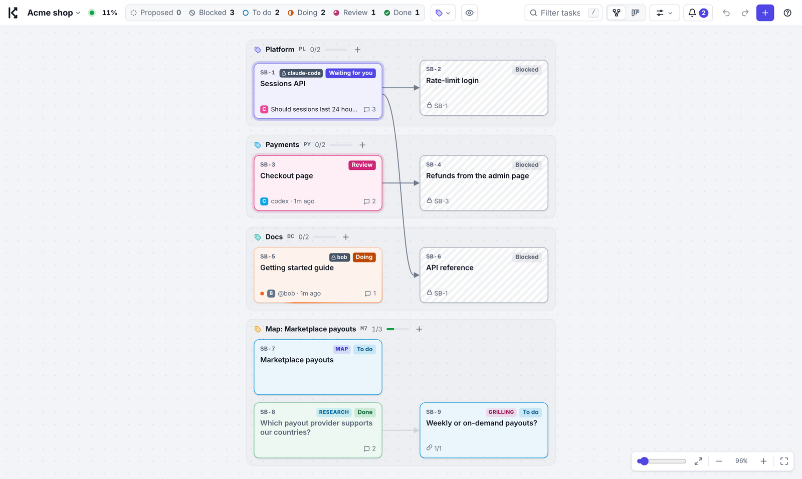
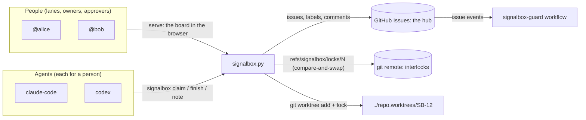
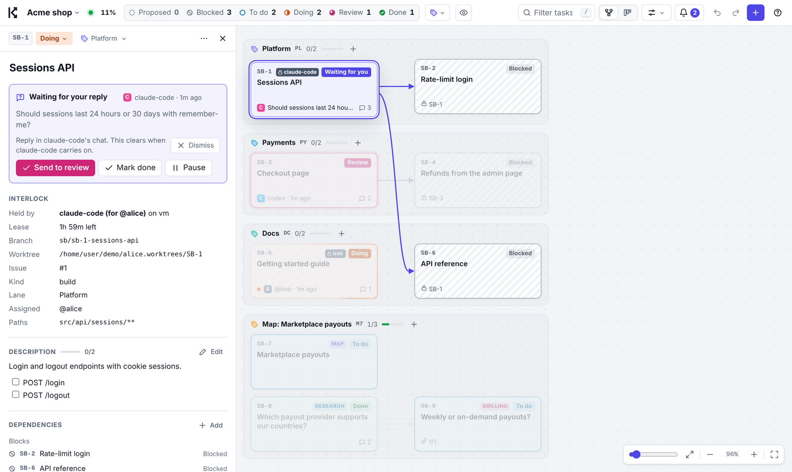

# Signalbox

**The interlocking board for teams of humans and AI agents.**

In a railway signal box, an *interlocking* makes conflicting routes impossible: two trains can never be signalled onto the same track. Signalbox does the same for work. Many people and many agents share one board on GitHub Issues. Every task anyone works on is held by an **interlock**, an atomic lock kept in git. Each claimed task gets its own **git worktree**. A state machine decides who may move what.



Signalbox is a fork of [Kanvas](https://github.com/XMihura/Kanvas) by Mihura (tracking Kanvas 0.5.0), which gave one person and their agents a shared, visual board. Signalbox scales it to **multiple groups of people and multiple agents at once**, and adds the planning model of Matt Pocock's [`/wayfinder`](https://github.com/mattpocock/skills/tree/main/skills/engineering/wayfinder) skill: maps, destinations, fog of war, a frontier, and decision tickets. Like Kanvas, it is plain Python 3.8+ with the standard library only, one HTML page, and no server of its own.

## Why

Agents are now cheap enough that a team runs a dozen at once, next to the people on the team. That breaks the tools in between:

| What you need | Kanvas | Wayfinder | Plain worktrees | **Signalbox** |
|---|---|---|---|---|
| A plan that outlives one chat | ✓ local `kanvas.json` | ✓ issue tracker | – | ✓ GitHub Issues, shared by every group |
| Visual board, live | ✓ | – | – | ✓ (Kanvas's graph and Kanban views) |
| Agents propose, people approve and review | ✓ | partly | – | ✓ enforced in the CLI **and** on GitHub |
| Several people with roles | – (one human) | – | – | ✓ lanes with owners, approvers, WIP limits |
| Two agents can't take the same task | file lock, one machine | assignee, racy | – | ✓ atomic compare-and-swap on a git ref, any machine |
| A crashed agent doesn't block a task forever | – | – | – | ✓ leases, heartbeats, take-over |
| Isolated checkout per task | – | – | ✓ | ✓ created, locked, set up and cleaned for you |
| Know who works where, on which branch | – | – | local only | ✓ on the board, for everyone |
| Spot two tasks changing the same files | – | – | – | ✓ `radar` and declared paths |
| Hand work to someone else, another machine | – | – | – | ✓ `handoff` pushes, `claim` resumes |
| Plan through fog, one decision at a time | – | ✓ maps | – | ✓ maps on the same board, HITL rules enforced |

## How it works



- **The hub is GitHub Issues.** A task is an issue labelled `signalbox`. Its state is a label (`sb:proposed`, `sb:todo`, `sb:doing`, `sb:review`), and done means closed. Its lane is a label (`lane:Payments`) and its kind is a label (`kind:research`). Dependencies sit in a small hidden block in the issue body and are mirrored to GitHub's native *blocked by* links. Notes are comments signed with who wrote them, and for whom. Anyone can follow along in GitHub itself, and every group shares the same hub.
- **The interlock is a git ref.** `claim` creates `refs/signalbox/locks/<issue>` on the shared remote with `git push --force-with-lease=<ref>:` (create only if absent). When two machines race, exactly one push wins. The ref points at a commit holding the lock record: holder, sponsor, host, branch, worktree and lease end. Renewing, taking over and releasing are compare-and-swap too. This needs no server and works on any git host; every move is a fast-forward, so remotes that forbid deletes and force-pushes work too. On a repository without a remote, the same locks live in local refs, which every worktree of the repository shares.
- **Each claim gets a worktree.** `../<repo>.worktrees/SB-12` on branch `sb/sb-12-<title>`, `git worktree lock`ed with the holder in its reason. Configured untracked files (such as `.env`) are copied in and a setup command runs. A unique port goes into `SB_PORT`, and a `TASK.md` brief tells the agent what it holds.
- **Rules are enforced twice.** The CLI refuses moves that are not yours to make: agents can't approve, nobody claims a blocked task, only the holder finishes. Human decisions need a person at a terminal, or the browser board. On GitHub, the `signalbox-guard` workflow undoes approvals, acceptances and YOLO made by agent accounts or non-approvers, using the identities GitHub records.

## The states, and who moves them

| State | Who moves it there | How |
|-------|--------------------|-----|
| Proposed | anyone (agents always land here) | `propose`, `batch`, `map new` |
| To do | an approver of the task's lane | the board, or `approve` in their terminal |
| Doing | whoever wins the interlock | `claim` (lock + worktree) |
| Review | the lock holder | `finish -m SUMMARY` (or `resolve` for decision tickets) |
| Done | an approver of the lane | the board, or `accept`; `send-back` returns it to To do with feedback |

Blocked is derived: a To-do task with unfinished dependencies. **YOLO** (from Kanvas) hands a chain to the agents. Everything the YOLO task depends on is done without review, and the YOLO task itself comes back for review.

## Quick start

You need git, Python 3.8+ and, for a GitHub hub, a token (`gh auth login`, or `GH_TOKEN`).

```bash
cd your-repo                       # origin on GitHub
python path/to/signalbox.py init   # config, agent skill, guard workflow, labels
git add .signalbox/config.json .agents .claude AGENTS.md .github && git commit -m "Set up Signalbox" && git push
python .agents/skills/signalbox/signalbox.py serve
```

`init` writes `.signalbox/config.json` and installs the agent skill and its own copy of Signalbox in `.agents/skills/signalbox/`, so agents and teammates need nothing installed. It also copies the skill to `.claude/skills/signalbox/` for Claude Code, registers the MCP server in `.mcp.json` (Claude Code) and `.agents/mcp_config.json` (Antigravity), adds `AGENTS.md` if you have none, adds `.github/workflows/signalbox-guard.yml`, and creates the labels on the hub. It never overwrites your files; rerun it to update the agents' copy of Signalbox. With `uv tool install` or `pipx install` on this repository, you get the `signalbox` command (and `sbx`).

Then ask your agent:

> Interview me about this project and plan it on the Signalbox board.

### Try it without GitHub

```bash
python scripts/demo.py /tmp/signalbox-demo
cd /tmp/signalbox-demo/alice && SIGNALBOX_USER=alice python /path/to/signalbox.py serve
```

The demo builds a shared remote, two people's clones and a file hub that stands in for GitHub Issues. Two agents race for a task, one asks a question, one finishes for review, a person takes a task, and a Wayfinder map has resolved research and fog left. The screenshots here are that demo.

## For agents

Agents read `.agents/skills/signalbox/SKILL.md`. The short version:

```bash
export SIGNALBOX_AGENT=claude-code          # sign everything; you act for the hub login (your sponsor)
signalbox status                            # what is happening, who holds what
signalbox claim SB-12 -m "Plan: ..." --paths "src/api/**"   # Locked: exit code 3 means someone else won
cd ../repo.worktrees/SB-12                  # work only here; read .signalbox/TASK.md
signalbox heartbeat SB-12                   # on long work, keep the lease
signalbox ask SB-12 "24h or 30d sessions?"  # and stop until the person answers
signalbox finish SB-12 -m "What changed, how I checked, what to look at"   # pushes, review, releases
signalbox handoff SB-12 --to bob -m "Half done: ..."                       # bob resumes with claim
```

## In Claude Code and Antigravity

After `init`, both pick Signalbox up from the repository itself, so it works the same on your laptop and in cloud sessions:

| | Claude Code (CLI, desktop, web) | Antigravity |
|---|---|---|
| Instructions | `.claude/skills/signalbox/SKILL.md` and `AGENTS.md` | `.agents/skills/signalbox/SKILL.md` and `AGENTS.md` |
| Tools | `.mcp.json` starts `signalbox mcp` (approve it once) | `.agents/mcp_config.json` starts `signalbox mcp` |
| Signature | the MCP client's name (`claude-code`), or `SIGNALBOX_AGENT` | the MCP client's name, or `SIGNALBOX_AGENT` |

`signalbox mcp` serves the agent commands as MCP tools (`signalbox_status`, `signalbox_next`, `signalbox_claim`, `signalbox_finish`, ...) over stdio, using only the standard library. It always acts as an agent, so no tool can approve, accept or break a lock. It finds the project from `--dir`, `$SIGNALBOX_DIR`, the client's workspace roots, or the folder it starts in. Where `python3` is not the name of Python (Windows), change `command` in those two files to `py` or `python`. Agents without MCP use the same commands through the shell, and `--json` gives them answers to parse.

## Running a software factory

Signalbox is the dispatcher, the lock manager and the review queue between your people and any number of headless agents:

```bash
# A worker: take the most useful ready task, work it in its own worktree, hand it to review. Repeat.
while signalbox next --claim --json --as worker-3 > claim.json; do
  wt=$(python3 -c 'import json; print(json.load(open("claim.json"))["claimed"]["worktree"])')
  (cd "$wt" && your-agent --prompt-file .signalbox/TASK.md)   # it calls `signalbox finish` itself
done   # exit code 2: nothing is ready
```

- **`next`** ranks ready tasks: work sent back with feedback first, then YOLO chains, handoffs to you, and what unblocks the most. `--claim` takes the best one and moves on when another worker wins the race. Filter with `--lane`, `--kind`, `--map`.
- **Quality gates**: `"checks": {"run": ["npm test", "npm run lint"]}` in the config runs those commands in the task's worktree on `finish`. A failure keeps the task in doing and tells the agent what failed; the results go into the summary people review. `verify` runs them alone. Only people may finish without them.
- **`--json`** on every command, with a stable task shape (state, lock, question, changes requested, sent-back feedback, YOLO) and errors as `{"error": ..., "locked": true}`.
- **`inbox`** tells a person what waits for them in one project: proposals to approve, work to review, their agents' questions, handoffs, expired leases. `inbox --all` searches every Signalbox board of yours (and `--owner ORG`) on GitHub.

## For people

- **`serve`** opens the board in your browser, acting as your GitHub login. Approve, ask for changes, review, send back, reject, turn YOLO on, and reshape the plan by dragging, all as in Kanvas. Every change becomes issue operations, checked against the same rules. Cards show who holds each interlock, and the panel shows the lease, branch, worktree, issue and declared paths. Starting work happens through `claim`, never by dragging to Doing: dragging a task to Doing is refused with the command to use instead.
- **Lanes** are teams or areas of work, with owners and an optional WIP limit (`add-lane Payments --owners bob --wip 3`, or `lanes` in the config). Owners and the global `approvers` decide for their lane, and GitHub teams work as `@org/team`.
- **YOLO** hands a chain to the agents (`yolo ID on`); `yolo ID stop` makes it cover only what the task waits on, so agents stop before it. Kanvas's image attachments are not shared through the hub yet: attach images to the issue on GitHub.
- **`unlock ID`** breaks a stuck lock (a person, at a terminal). `claim ID --take-over` takes over a lock whose lease ran out. `gc` releases locks of finished tasks and removes their worktrees and merged branches. `doctor` checks access and invariants.



## Maps: Wayfinder on the board

For an effort too big and too unclear for one session:

```bash
signalbox map new "Marketplace payouts" --destination "A spec for weekly seller payouts, agreed by finance"
signalbox propose - "Which provider covers our countries?" --map SB-7 --kind research
signalbox propose - "Weekly or on demand?" --map SB-7 --kind grilling --deps SB-8
signalbox fog SB-7 --add "How disputes claw back paid-out money"
signalbox frontier SB-7                      # open, unblocked, unclaimed tickets
signalbox resolve SB-8 -m "Stripe Connect: all 14 countries"   # accepted -> joins "Decisions so far"
signalbox graduate SB-7 disputes "Who pays for a lost dispute?" --kind grilling
signalbox scope-out SB-11 -m "Tax reporting is its own effort"
```

The map is an issue with Wayfinder's sections: Destination, Notes, Decisions so far, Not yet specified, and Out of scope. Its tickets are native sub-issues, and on the board each map is a swimlane. Two Wayfinder rules are enforced rather than just advised. **HITL tickets** (`grilling`, `prototype`) can only be claimed by an agent `--with` the person it works with. A **map is an index**: it can't be claimed, only its tickets can.

## Configuration

`.signalbox/config.json` is shared through git. Everything else in `.signalbox/` stays local: the mirror the browser reads, the cache, and the file hub.

```json
{
  "title": "Acme shop",
  "prefix": "SB",
  "hub": {"type": "github", "repo": "acme/shop"},
  "approvers": ["alice"],
  "lanes": [{"name": "Payments", "prefix": "PY", "owners": ["bob", "@acme/payments"], "wip": 3}],
  "agents": {"lease_minutes": 120, "max_claims": 2, "hitl_needs_pair": true, "logins": ["acme-agents-bot"]},
  "locks": {"remote": "auto", "namespace": "refs/signalbox/locks"},
  "worktrees": {"dir": "../{repo}.worktrees", "base": "", "copy": [".env"], "setup": "npm ci", "port_base": 4100},
  "paths": "warn",
  "checks": {"run": ["npm test"], "block": true, "timeout_seconds": 1800}
}
```

`agents.logins` names the GitHub accounts your agents use. Give agents their own bot account or GitHub App: then GitHub, and so the guard, can tell an agent from its sponsor. Remotes that accept only branches (some proxies and locked-down hosts) take `"locks": {"namespace": "refs/heads/sb-lock"}`; `doctor --probe` tells you whether you need it. `"paths": "block"` turns overlapping declared paths from a warning into a refusal. `"hub": {"type": "file"}` keeps the hub in a local JSON file, for a single machine, offline work and tests.

## Commands

| | |
|---|---|
| Read | `status`, `inbox [--all]`, `next`, `ready`, `frontier [MAP]`, `blocked`, `list [FILTER]`, `show ID`, `locks`, `worktrees`, `radar`, `whoami`, `check`, `doctor` |
| Work (agents and people) | `next --claim`, `claim`, `heartbeat`, `note`, `ask`, `verify`, `finish [--pr]`, `resolve`, `pause`, `handoff`, `unlock` (your own lock) |
| Plan | `propose`, `batch`, `add-lane`, `depend`, `undepend`, `edit`, `withdraw`, `map new/show`, `fog`, `graduate`, `scope-out` |
| Decide (people) | `approve`, `changes`, `accept`, `send-back`, `reject`, `yolo`, `unlock` (anyone's) |
| Run | `init`, `serve`, `mcp`, `sync`, `gc`, `export`, `guard` |

Every command takes `--json`. `signalbox <command> -h` explains each one. [DESIGN.md](DESIGN.md) covers the design decisions, the guarantees and their limits.

## Security

Signalbox holds GitHub tokens, runs git and shell commands, and feeds text to agents, so it treats the hub, the lock refs and the repository's branches as places other people write:

- **Identity comes from the token.** On GitHub you are whoever your token belongs to; `SIGNALBOX_USER` cannot change that, and an agent's sponsor is the token's owner. An identity GitHub does not confirm, or an agent account's token, makes no human decisions.
- **The config that rules is the main checkout's.** A task branch cannot change approvers, the hub, the setup command or the checks until it is merged. The token goes only to `api.github.com`, the host of your `origin`, or a host you name in `SIGNALBOX_GITHUB_HOSTS`.
- **Lock records are data, not commands.** Branch names and worktree paths from them are checked before git sees them; locks are told apart by agent *and* sponsor.
- **Outside text is marked.** Comments and issues by people who are not owners, members or collaborators are flagged as information, not instructions, in briefs, `show`, JSON and MCP; signatures that claim another person show who really posted them.
- **The board server is private.** `serve` makes a secret key per session, opens the board with it, and refuses requests without it, so another account on the machine, or an agent that would rather approve its own work, cannot act as you through it.
- **The guard closes GitHub's side**: approvals however they are labelled, send-backs, acceptances, rejections, YOLO, and agent accounts rewriting approved tasks, by any account that may not decide, bots included. It reads the rules from the default branch.

Limits and the reasoning behind each choice are in [DESIGN.md](DESIGN.md#trust-boundaries). Report security problems privately to the maintainers rather than in an issue.

## Development

```bash
python -m unittest discover -s tests -v
```

`tests/test_signalbox.py` drives real git repositories: a bare remote and two clones racing for locks, handing work off, and reviewing it. It also checks the GitHub tracker against a fake REST API. Kanvas's own suite still runs against the engine. Contributor notes are in [AGENTS.md](AGENTS.md), and the engine's documentation is in [docs/KANVAS.md](docs/KANVAS.md).

## Credits and license

MIT. Built on [Kanvas](https://github.com/XMihura/Kanvas) by Mihura (MIT), whose board, engine and workflow are the foundation here. The map model follows [Wayfinder](https://github.com/mattpocock/skills) by Matt Pocock.
